# MarketVault Academy

[](https://marketvaultacademy.ru)
[](#проверки)
[](docs/challenge-matrix.md)

Живой стенд: <https://marketvaultacademy.ru>

Учебный стенд по веб-безопасности, который выглядит и работает как настоящий интернет-магазин
электроники. Внутри живой витрины спрятаны **32 намеренно уязвимых сценария**: вход и сессии,
API и GraphQL, устаревший PHP-портал, склад на Go, отзывы с голосованием и оформление заказа.

Стенд сделан для практики, а не для коллекционирования флагов: задания разложены по трекам,
у каждого есть методология разбора, вопросы для самопроверки и разбор того, как ошибку чинить.

> Проект намеренно уязвим. Запускайте его только в изолированном окружении, не подключайте
> реальные данные, секреты и платёжные системы и не выставляйте наружу без понимания рисков.

## Скрины

Светлая тема, стенд целиком: от витрины и кошелька до заданий, треков и разбора.
Все снимки лежат в [`docs/screenshots`](docs/screenshots) и сняты на текущей вёрстке
(тёмная тема — та же вёрстка с другим набором токенов).

|  |  |
| --- | --- |
| 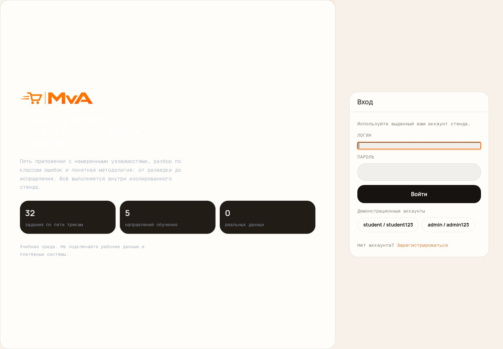<br><sub>Вход и демо-аккаунты</sub> | 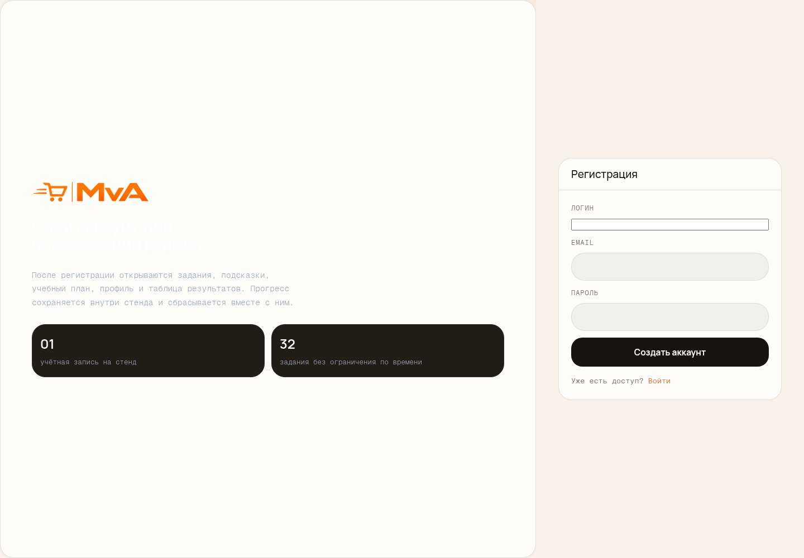<br><sub>Регистрация</sub> |
| 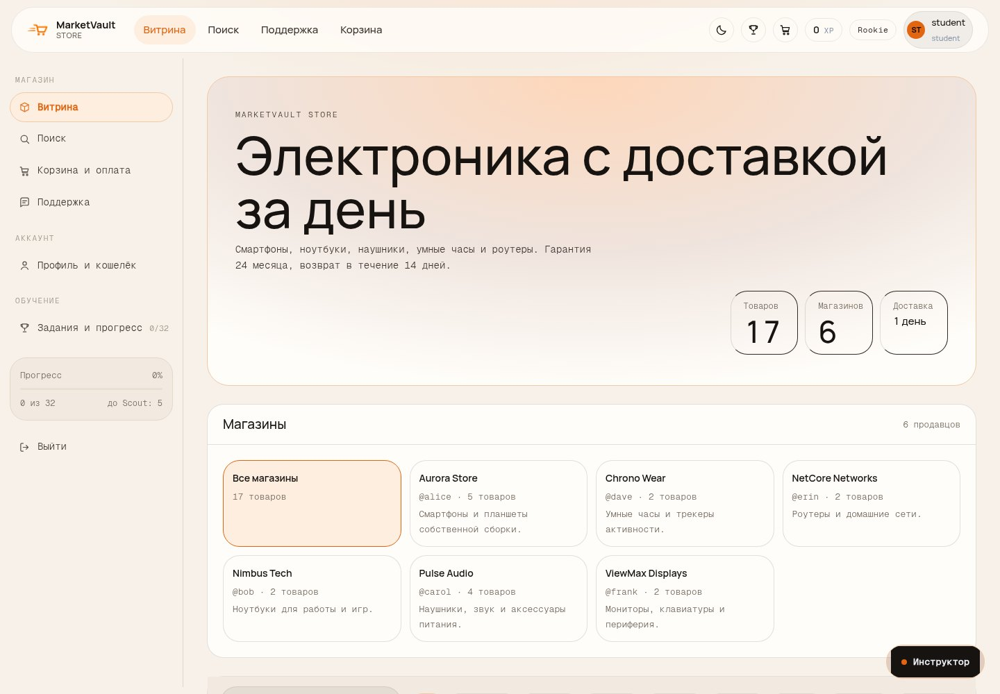<br><sub>Витрина магазина</sub> | 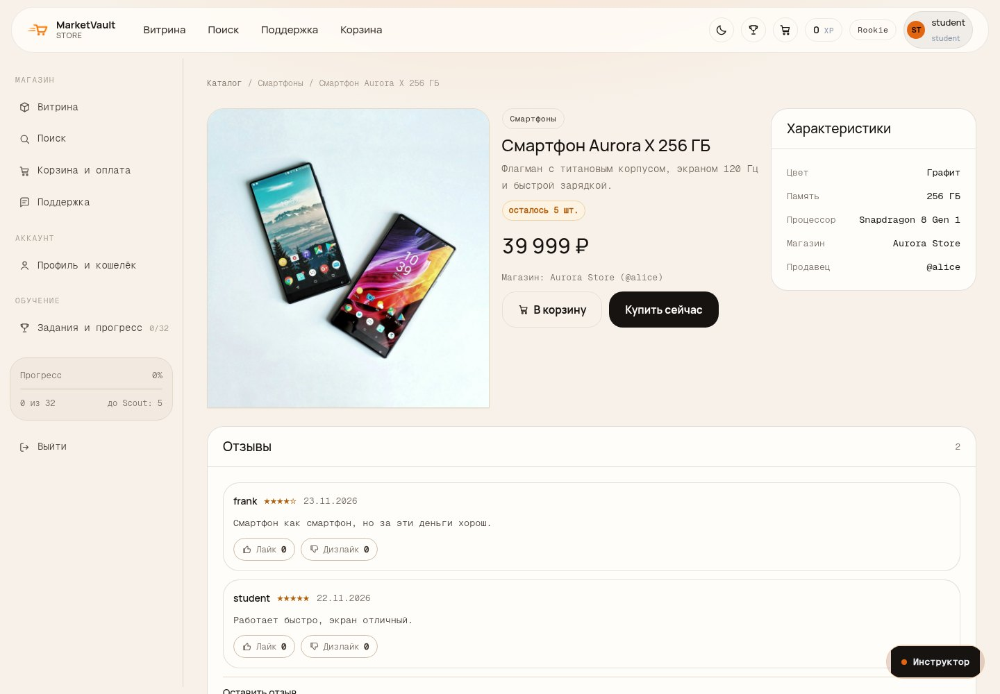<br><sub>Карточка товара</sub> |
| 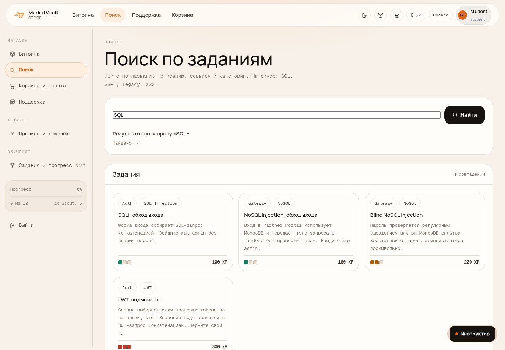<br><sub>Поиск по заданиям</sub> | 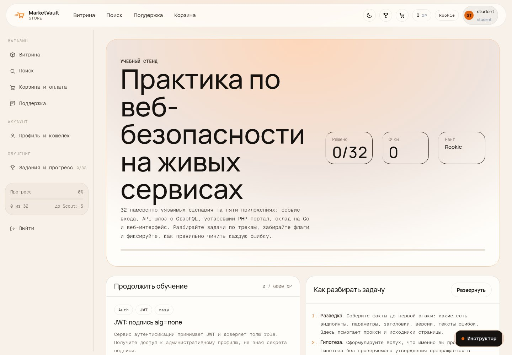<br><sub>Задания и прогресс</sub> |
| 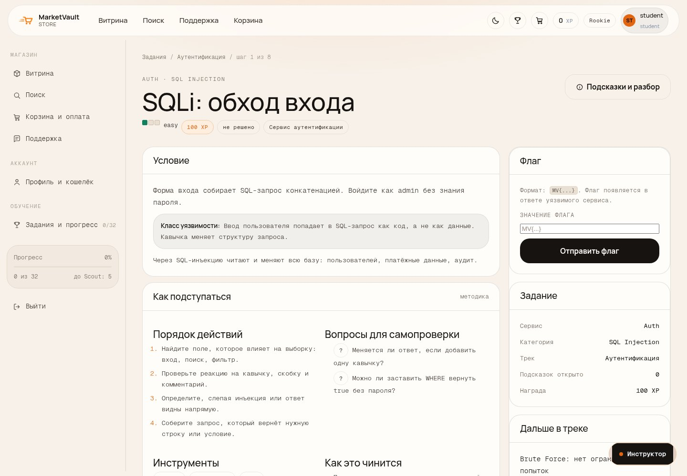<br><sub>Задание: условие и флаг</sub> | 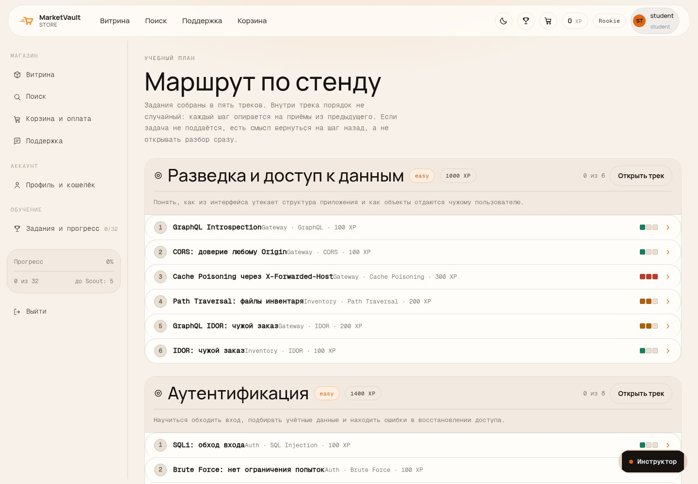<br><sub>Учебный план</sub> |
| 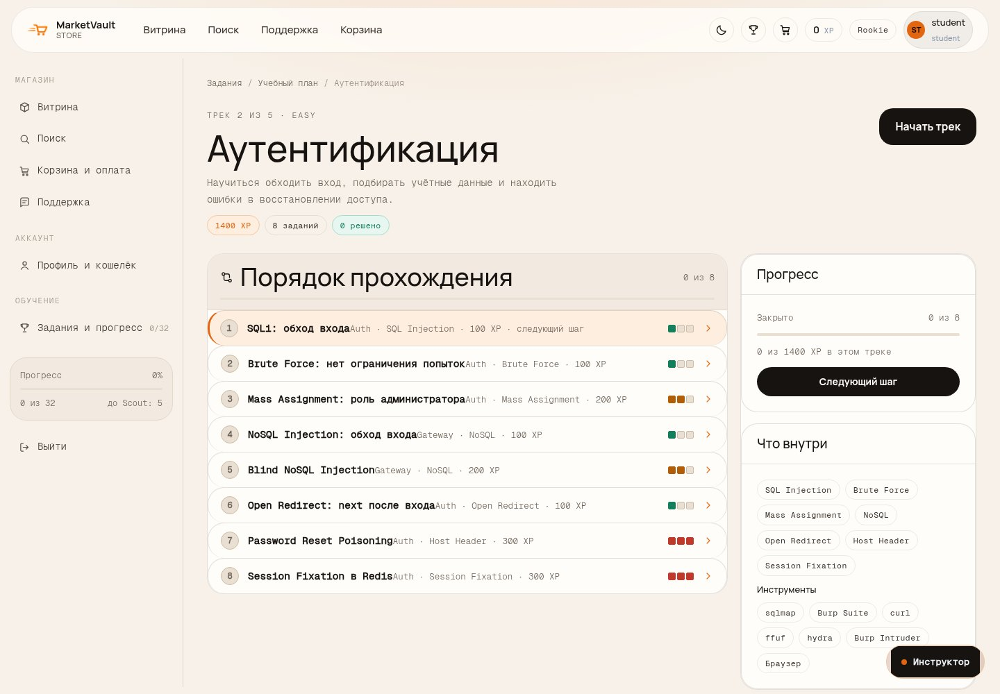<br><sub>Трек «Аутентификация»</sub> | 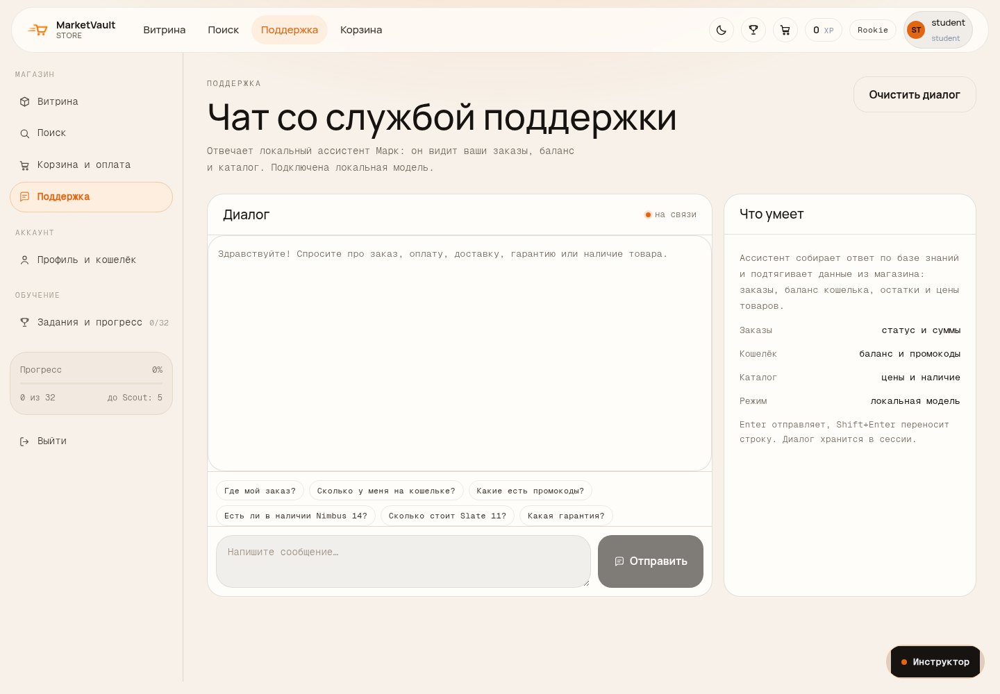<br><sub>Чат поддержки</sub> |
| 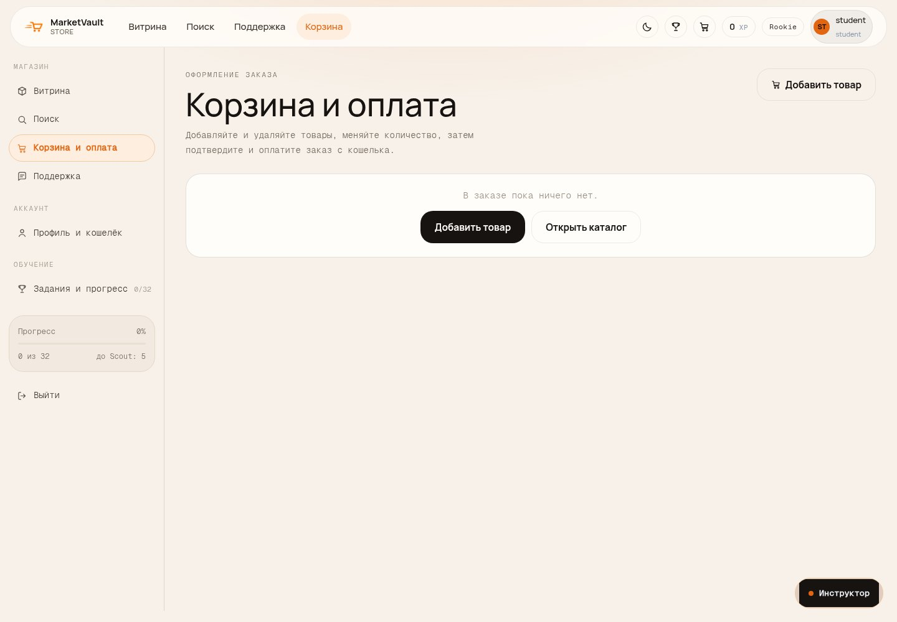<br><sub>Корзина и оплата</sub> | 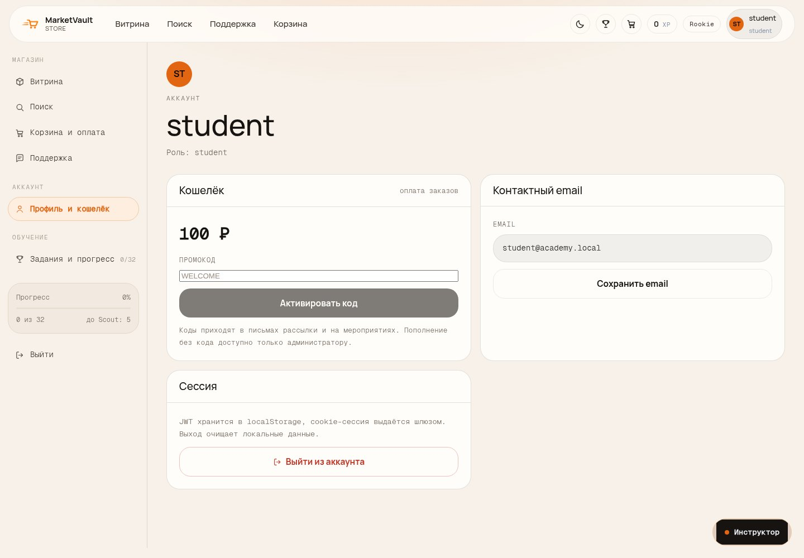<br><sub>Профиль и кошелёк</sub> |
| 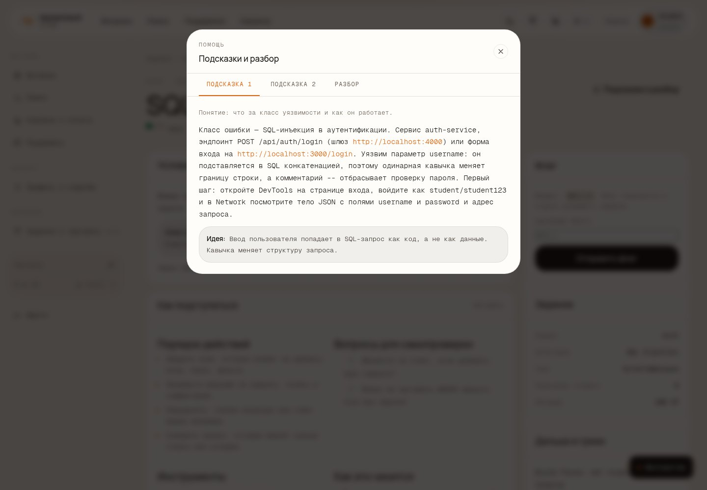<br><sub>Подсказка по заданию</sub> | 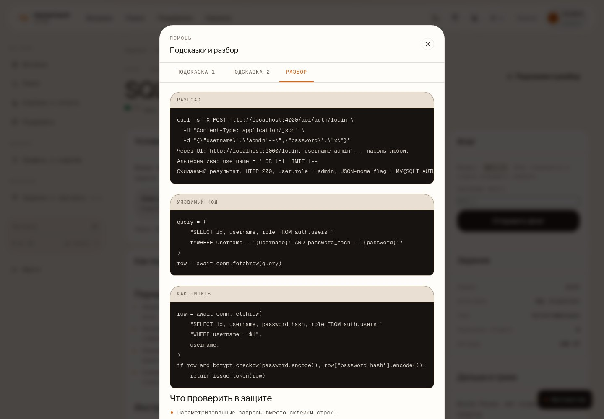<br><sub>Разбор с payload</sub> |

## Что внутри

- **Витрина**: 17 товаров в 8 категориях — смартфоны, ноутбуки, наушники, умные часы, роутеры,
  планшеты, мониторы и аксессуары. Фотографии, характеристики, остатки на складе.
- **Магазины**: 6 продавцов со своими каталогами (Aurora Store, Nimbus Tech, Pulse Audio,
  Chrono Wear, NetCore Networks, ViewMax Displays).
- **Корзина и оформление**: добавление товара из каталога, изменение количества, удаление,
  подтверждение заказа и оплата с кошелька.
- **Кошелёк**: баланс, история активаций, промокоды. Свободное пополнение доступно только
  администратору.
- **Отзывы**: оценка, текст, лайки и дизлайки с счётчиками.
- **Чат поддержки**: локальный ассистент отвечает по-русски и видит ваши заказы, баланс,
  остатки и цены. Может работать как на встроенном движке, так и на локальной модели.
- **Обучение**: 32 задания, 5 треков, подсказки в два уровня, разбор уязвимого и безопасного
  кода, плавающий инструктор и достижения.
- **Темы**: тёмная «soot + orange» включена по умолчанию, светлая — тем же переключателем
  в шапке; выбор запоминается.
- **Инфраструктура**: PostgreSQL, MongoDB, Redis и шесть собственных сервисов.
- **Автотесты**: эксплуатация всех сценариев, проверка изоляции и аудит секретов.

## Стек

| Слой | Технология | Порт |
|------|------------|------|
| frontend | React + Vite | 3000 |
| api-gateway | Node.js + Express | 4000 |
| auth-service | Python + FastAPI | внутренний 8000 |
| legacy-service | PHP + Apache | внутренний 80 |
| inventory-service | Go | внутренний 8080 |
| stats-service | Python + Flask | внутренний 8000 |
| PostgreSQL | 16 | внутренний 5432 |
| MongoDB | 7 | внутренний 27017 |
| Redis | 7 | внутренний 6379 |

## Запуск

Нужны Docker 24+ и Docker Compose v2. Больше ничего ставить не надо.

```bash
git clone https://github.com/Lon-ik/MarketVault-Academy-CTF.git
cd MarketVault-Academy-CTF
./scripts/start.sh
```

Скрипт делает всё сам:

1. проверяет Docker, Compose и занятость портов 3000 и 4000;
2. создаёт `.env` из `.env.example`, если файла ещё нет;
3. генерирует флаги, если их нет;
4. собирает образы и поднимает контейнеры;
5. ждёт инициализацию PostgreSQL и записывает флаги в базу;
6. дожидается ответа API и интерфейса и печатает адреса и аккаунты.

Повторный запуск безопасен: уже работающий стенд не пересоздаётся, данные не теряются.

| Команда | Что делает |
|---------|------------|
| `./scripts/start.sh` | поднять стенд или достроить запущенный |
| `./scripts/start.sh --fresh` | удалить тома и поднять заново |
| `./scripts/start.sh --rotate-flags` | сгенерировать новый набор флагов |
| `./scripts/start.sh --no-build` | не пересобирать образы |

- Интерфейс: <http://localhost:3000>
- API: <http://localhost:4000>

Если `python3` в системе нет, флаги сгенерируются во временном контейнере
`python:3.12-alpine` — отдельно ставить Python не нужно.

### Остановка

```bash
docker compose down          # остановить
docker compose down -v       # остановить и удалить данные
docker compose logs -f       # смотреть логи
```

### Публикация наружу

Публичный IP не нужен: наружу стенд выходит исходящим туннелем Cloudflare.

Быстрый вариант — адрес меняется при каждом запуске:

```bash
cloudflared tunnel --url http://localhost:3000
```

Постоянный домен:

```bash
cloudflared tunnel login        # один раз: в браузере выбираете зону
./scripts/tunnel.sh             # создать туннель и привязать домен
./scripts/tunnel.sh --service   # то же + автозапуск systemd
```

Скрипт создаёт именованный туннель, прописывает DNS для `DOMAIN` и `www.DOMAIN`
(по умолчанию `marketvaultacademy.ru`) и направляет оба хоста на `http://localhost:3000`.
Сертификат и HTTPS выдаёт Cloudflare, порты на роутере открывать не нужно.
Переменные: `DOMAIN`, `TUNNEL_NAME`, `ORIGIN`.

## Учётные записи

| Логин | Пароль | Роль |
|-------|--------|------|
| student | student123 | покупатель, стартовый баланс 100 ₽ |
| admin | admin123 | администратор, может пополнять кошелёк |
| alice, bob, carol, dave, erin, frank | student123 | продавцы магазинов |

Регистрация новых аккаунтов открыта и доступна из интерфейса.

## Магазин

### Кошелёк и промокоды

Свободного пополнения для обычных пользователей нет — кнопка убрана, а эндпоинты
`POST /api/wallet/topup` и `POST /api/inventory/wallet/topup` отвечают `403`.
Администратору доступно ручное пополнение в профиле.

Остальным баланс пополняется промокодами (каждый код — один раз на пользователя):

| Код | Сумма |
|-----|-------|
| WELCOME | 5 000 ₽ |
| MV2026 | 10 000 ₽ |
| SECURITYDAY | 25 000 ₽ |
| DEBUG-ACCESS | 100 000 ₽ |

`DEBUG-ACCESS` — служебный код с ограниченным тиражом. В списке, который показывает чат
поддержки, его нет: найти его можно только перебором или чтением базы.

### Оплата

Заказ оплачивается с внутреннего кошелька. Цены хранятся в копейках, списание и уменьшение
остатка идут в одной транзакции уровня запроса.

### Возврат остатков

Витрину нельзя скупить целиком: изначальные остатки лежат в `inventory.stock_baseline`
(сид `db/init/14_stock_baseline.sql`), а `api-gateway` раз в 15 минут возвращает их
в `inventory.products`. Интервал задаётся переменной `STOCK_RESET_MINUTES`
(по умолчанию 15 минут).

## Поддержка

Чат поддержки — не заглушка. Локальный ассистент «Марк» отвечает по-русски, разбирает вопрос
на токены, ищет совпадения по базе знаний и **подставляет живые данные**: ваши последние
заказы, баланс кошелька, остатки и цены товаров.

Примеры:

- «где мой заказ» → список последних заказов с номерами, суммами и статусами;
- «какие есть промокоды» → действующие коды с суммами;
- «есть ли в наличии Nimbus 14» → остаток по складу;
- «сколько стоит Slate 11» → цена из каталога.

Диалог хранится в сессии, есть кнопка очистки и подсказки с частыми вопросами.

### Локальная модель

По умолчанию работает встроенный движок правил. Если хотите модель на 0.5B параметров:

```bash
./scripts/support-model.sh          # поднимет модель и покажет настройки
```

Скрипт запускает llama.cpp, Ollama или контейнер с Ollama и печатает переменные
`SUPPORT_LLM_URL` и `SUPPORT_LLM_MODEL`. После этого шлюз пересылает ассистенту найденные
факты, а модель формулирует ответ. Если модель недоступна, чат молча возвращается к движку правил.

## Обучение

1. **Учебный план** (`/path`) собирает задания в пять треков: разведка и доступ к данным,
   аутентификация, токены и подписи, серверные инъекции, клиент и бизнес-логика.
2. **Страница трека** (`/track/:id`) показывает порядок шагов и подсвечивает текущий.
3. **Карточка задания** — условие, класс уязвимости, порядок действий, вопросы для
   самопроверки, инструменты и ссылки на первоисточники.
4. **Инструктор** в правом нижнем углу подсказывает следующий шаг, не выдавая решение.
5. **Подсказки и разбор** открываются отдельно, факт просмотра сохраняется.
6. **Панель заданий** — кнопка с кубком в шапке: полупрозрачная панель с размытием,
   прогресс, ранг и список всех 32 заданий.
7. **Прогресс привязан к устройству**: решения хранятся в `academy.device_progress`
   и живут в cookie браузера, поэтому смена аккаунта прогресс не сбрасывает,
   а другой браузер начинает с чистого листа.

## XP и ранги

| Сложность | XP |
|-----------|-----|
| easy | 100 |
| medium | 200 |
| hard | 300 |

Ранги: Rookie → Scout → Hunter → Specialist → Elite → Legend.

## Оформление

Тёмная тема «soot + orange furnace» по справочнику NestJS: канвас `#0a0603`, акцент
`#f97316` работает как свет — свечения, а не плоские заливки, поверхности
`#0b0b0b` / `#181818`, границы волосяные `rgba(255, 255, 255, 0.15)`, мягких теней нет.

- **Шрифты**: Manrope для заголовков (500, нулевой трекинг) и Geist Mono 300 для наборного
  текста; подключены локально через `@fontsource`, внешние CDN не нужны.
- **Формы**: радиусы 32/24/20/12 и пилюли, стеклянная навигация, светящаяся рамка героя.
- **Темы**: тёмная включена по умолчанию, светлая — тёплый пергамент с тем же акцентом,
  переключатель в шапке, выбор запоминается.

Все экраны — в [docs/screenshots](docs/screenshots) (светлая тема).

## Изоляция

Стенд намеренно уязвим, поэтому границы проведены так, чтобы приёмы не выходили за пределы
лаборатории:

- легаси-портал живёт в отдельной internal-сети `legacy`: из него виден только шлюз,
  а не PostgreSQL, Redis и соседние сервисы, и в его окружении нет учётных данных БД;
- контейнер легаси — `read_only` с tmpfs для `/tmp` и `uploads` (64 МБ), `pids_limit: 128`,
  лимиты памяти и CPU, `no-new-privileges`;
- порты `3000` и `4000` опубликованы только на `127.0.0.1`, сети `backend` и `legacy` —
  `internal: true`, поэтому из контейнеров нет выхода ни в интернет, ни на хост;
- `auth-service` ходит в базу ролью `auth_service` с минимальными правами: SQL-инъекция
  в логине не даёт `pg_read_file`, `COPY ... FROM PROGRAM` и доступа к схеме `inventory`;
- `docker.sock` никуда не проброшен, файлы флагов смонтированы только на чтение.

## Проверки

```bash
./scripts/run-tests.sh        # эксплуатация всех сценариев + приём флагов
./scripts/verify-isolation.sh # наружу доступны только 3000 и 4000
./scripts/check-secrets.sh    # секреты и флаги не попадают в Git
./scripts/db-verify.sh        # сводка по заданиям и прогрессу устройств
```

Ожидаемый результат тестов: `TOTAL 37 | PASS 37 | SKIP 0 | FAIL 0`.

## Структура

```
marketvault-academy/
├── docker-compose.yml
├── .env.example
├── db/
│   ├── init/                 # схемы, каталог товаров, задания, подсказки
│   └── mongo/                # партнёрские аккаунты
├── services/
│   ├── api-gateway/          # Express, GraphQL, прокси, академия, магазин, поддержка
│   ├── auth-service/         # FastAPI, JWT, сессии
│   ├── inventory-service/    # Go, товары, кошелёк, заказы
│   ├── legacy-service/       # PHP + Apache
│   ├── stats-service/        # внутренний Flask-сервис
│   └── frontend/             # React + Vite
├── docs/
│   ├── architecture.md
│   ├── api-contracts.md
│   ├── challenge-matrix.md
│   ├── manual-testing.md
│   └── screenshots/
├── scripts/                  # start, tunnel, support-model, reset, flags, tests, isolation, db-verify
├── tests/                    # интеграционные тесты
└── README.md
```

## Флаги

Флаги генерируются в `runtime/` и не попадают в Git. В seed лежит заглушка `MV{UNSET}`.

```bash
python3 scripts/flags.py generate          # создать флаги, если их нет
python3 scripts/flags.py sync              # записать флаги в PostgreSQL
ROTATE_FLAGS=1 ./scripts/reset.sh          # полностью новый набор флагов
```

## Уязвимости

Все 32 сценария перечислены в [docs/challenge-matrix.md](docs/challenge-matrix.md),
порядок ручной проверки — в [docs/manual-testing.md](docs/manual-testing.md).

Вместе с витриной добавлены ещё два намеренных дефекта, которых нет в списке заданий —
они нужны, чтобы витрина не была «безопасной декорацией»:

- **накрутка голосов**: лимит «один голос на пользователя» есть, но проверка и запись
  разнесены во времени, поэтому параллельные запросы его обходят;
- **гонка при оформлении заказа**: `POST /api/checkout` проверяет остаток до паузы 1.5 с
  и списывает его после, без `SELECT ... FOR UPDATE`.

Отдельно стоит помнить, что отзыв можно подписать чужим именем, а личность голосующего
берётся из тела запроса, если она там передана.

## Изображения товаров

Фотографии лежат в `services/frontend/public/products/` и отдаются локально, поэтому витрина
работает без интернета. Источники, авторы и лицензии — в
[docs/image-credits.md](docs/image-credits.md).
